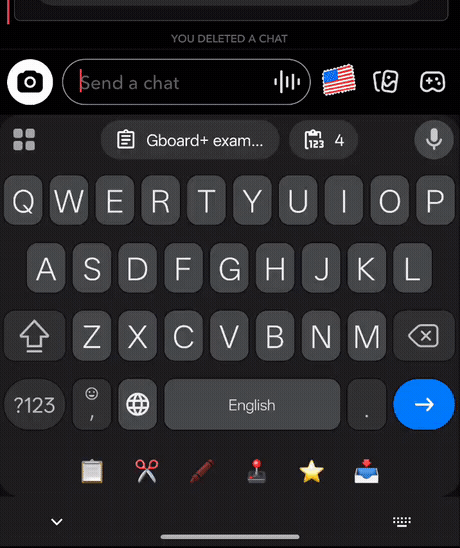
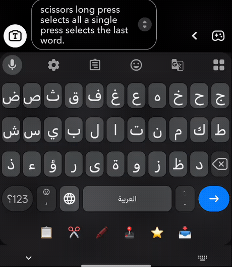
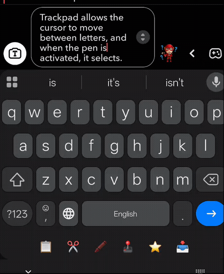
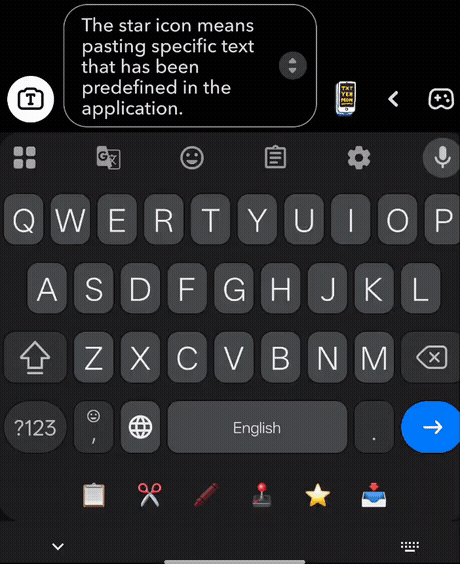
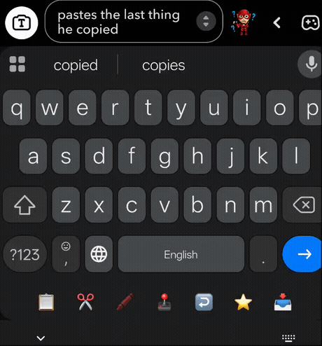

# Gboard+ 

A Gboard toolbar with a **clipboard vault (text + images)**, **shortcuts**, **cursor/trackpad
tools**, **select mode** and **screenshot capture** — delivered as a standalone LSPosed module.

Gboard+ was **extracted from [Auto Expand]** so the Gboard feature lives in its own module with an
isolated scope, preferences and storage. Both modules can be installed at the same time without
fighting over Gboard.

> Not affiliated with Google. "Gboard" is a trademark of Google LLC. See the logo note below.

---

## Features

- **Toolbar row** above the keyboard, sized to your layout.
- **Buttons:** Clipboard, Paste, Select-all (tap = word · long-press = field), Cursor nav,
  Trackpad stick, Select-mode toggle, Text shortcut (tap/long-press).
- **Clipboard vault:** history, pin, favourite, search, capacity limit, full-text/one-line rows.
- **Image vault:** save copied images, dedup by hash, entry + byte budgets.
- **Screenshots:** auto-capture into the vault; optionally push to the clipboard.
- **Undo:** shake-to-undo and/or an Undo button, with sensitivity.
- **Haptics:** vibration strength, trackpad haptics and sensitivity.
- **Liveness card:** tells you whether the module is actually loaded in Gboard, with a one-tap
  restart.
- **Auto Expand handoff:** if AE's Gboard tweak is still on, Gboard+ removes AE's toolbar row and
  offers a one-tap (root) takeover.

## Toolbar buttons

The strip above the keyboard. Every demo below loops on its own — no need to press play.

<table>
<tr>
<td align="center" width="50%">
  <br>
  <b>📋 Clipboard</b><br>
  Opens the clipboard vault — a history of everything you copied (text and images) with pin,
  favourite, search and delete.
</td>
<td align="center" width="50%">
  <br>
  <b>✂️ Select</b><br>
  A single tap selects the last word; a long-press selects everything. Opens the
  Cut / Copy / Paste / Share bar.
</td>
</tr>
<tr>
<td align="center" width="50%">
  <br>
  <b>🕹️ Trackpad (+ 🖍️ select mode)</b><br>
  Drag to move the cursor letter-by-letter. Turn on the pen (🖍️ select mode) and the same drag
  highlights a selection instead.
</td>
<td align="center" width="50%">
  <br>
  <b>⭐ Text shortcut</b><br>
  Inserts text you predefined in the app — tap inserts shortcut 1, long-press inserts shortcut 2.
</td>
</tr>
<tr>
<td align="center" width="50%">
  <br>
  <b>📥 Paste</b><br>
  Pastes the last thing you copied. If the newest vault entry is an image or screenshot, it pastes
  that image instead.
</td>
<td align="center" width="50%"></td>
</tr>
</table>

## Requirements

- Rooted device with **LSPosed** (Zygisk/Riru).
- **Android 15+** (verified on Android 16 / OxygenOS), **arm64-v8a**.
- **Gboard** installed (verified against 18.4.1).
- **Root is optional**: the core toolbar, vault, images and screenshots work without it. Root only
  unlocks automatic force-stop reload and the one-tap AE takeover.

## Install

1. Install the APK.
2. Open **LSPosed Manager → Modules**, enable **Gboard+**.
3. In **Scope**, select **Gboard** (`com.google.android.inputmethod.latin`) only, then reboot.
4. Open the **Gboard+** app. If the card says *not loaded*, tap **Force stop Gboard** (root) or
   **Open Gboard app info → Force stop**, then open the keyboard once.

## Coexistence with Auto Expand

Gboard+ and Auto Expand can both be installed:

- Gboard+ is scoped **only** to Gboard; AE keeps SystemUI and global search.
- All Gboard+ preferences, files, authorities and broadcast actions are namespaced `gbp_*` /
  `io.github.kvmy666.gboardplus.*` and never touch AE's `ae_*` channels.
- If AE's Gboard toolbar is still enabled, Gboard+ **removes AE's toolbar row in-process** so you
  see a single bar, and shows a handoff card. With root, one tap disables AE's toggle and enables
  Gboard+ — Gboard+ does everything AE's keyboard tweak did.
- Gboard+ **adopts your existing clipboard vault** (`clipboard.db`) with no data loss.

## Build

```bash
# JDK 17+ required
./gradlew assembleDebug     # debug APK
./gradlew testDebugUnitTest # unit tests
./gradlew assembleRelease   # release APK (needs keystore.properties or KEYSTORE_* env)
```

Release signing reads `keystore.properties` at the repo root, or the `KEYSTORE_FILE`,
`KEYSTORE_PASSWORD`, `KEY_ALIAS`, `KEY_PASSWORD` environment variables.

## Project layout

```
app/                Android module (settings app + Xposed hook)
  src/main/assets/xposed_init          → GboardPlusHook
  src/main/res/values/arrays.xml       → xposed_scope = Gboard only
docs/               requirements · design · database · architecture · test-plan
logo/               Gboard-derived icon + generator (build_logo.py)
.env                local secrets (git-ignored, never committed)
```

## Documentation

- [requirements.md](docs/requirements.md) — functional + non-functional requirements
- [design.md](docs/design.md) — UI/UX, colour system, logo
- [database.md](docs/database.md) — ERD + schema
- [architecture.md](docs/architecture.md) — components + sequences
- [test-plan.md](docs/test-plan.md) — unit tests, test cases, conflict matrix

## Support & feedback

- **Report a bug / ask a question:** Telegram **[@kvmy1](https://t.me/kvmy1)**
- **Issues:** [open an issue](https://github.com/kvmy666/Gboard/issues) — include your device, Android
  version, Gboard version, and `adb logcat -s GboardPlus`.

## Logo note (trademark)

The launcher mark is derived from Google's Gboard application icon
(`logo/source/res/aQv.webp`, pulled from the installed app), recoloured to `#F03971` with a `+`
badge. It is intended for personal, non-commercial use; redistribute only if you replace the glyph
with an original mark.

## License

Personal project. See repository for terms.
