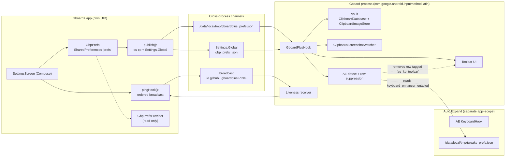
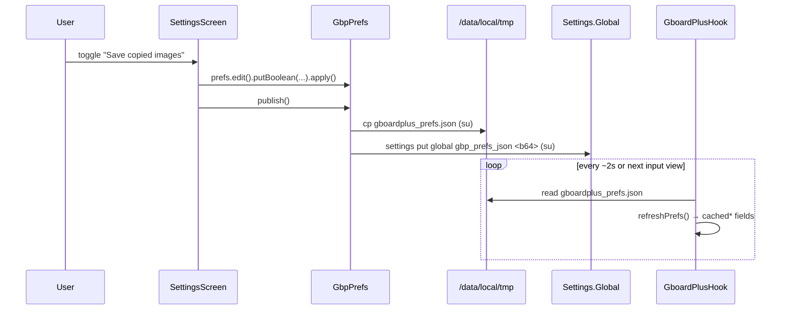
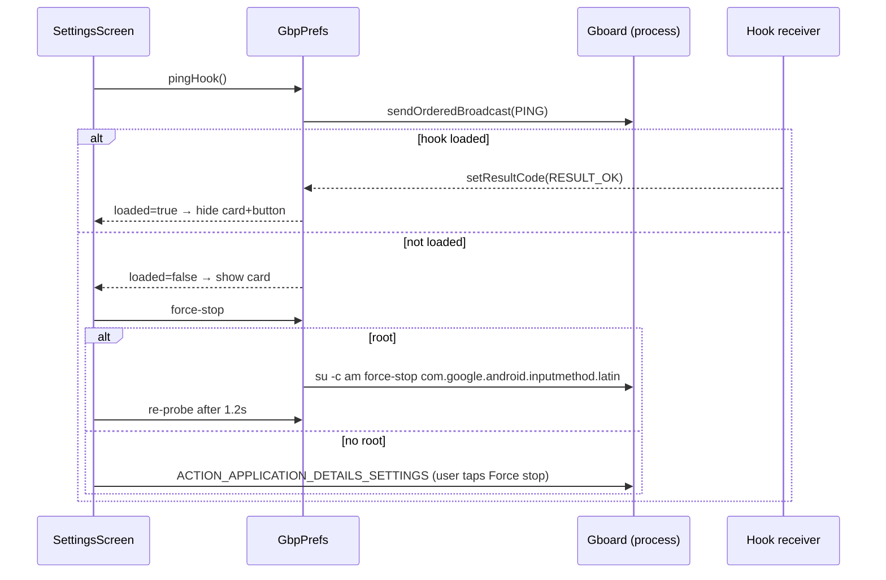

# Gboard+ — Architecture

- **Status:** Draft
- **Related:** [requirements.md](requirements.md) · [database.md](database.md)

## 1. Overview

Gboard+ has two execution contexts that never share memory:

1. **Settings app** (`io.github.imix667.gboardplus`, own UID) — Compose UI, owns the
   `SharedPreferences("prefs")`, publishes a flat JSON snapshot, probes liveness, runs opt-in
   root actions.
2. **Hook** (`GboardPlusHook`, running **inside Gboard's process** via LSPosed) — reads the
   snapshot, injects the toolbar, owns the clipboard/image vault (the DB physically lives in
   Gboard's data dir), and answers liveness pings.

They communicate through the filesystem/global-settings/IPC only. All identifiers are isolated
from Auto Expand (`gbp_*`, `io.github.imix667.gboardplus.*`), and the single intentional AE
touch-point is the handoff.

## 2. Component diagram



## 3. Pref propagation (sequence)



## 4. Toolbar injection (sequence)

```mermaid
sequenceDiagram
    participant GB as Gboard
    participant H as GboardPlusHook
    participant V as Keyboard content layout
    GB->>H: InputMethodService.setInputView(view) [after hook]
    H->>H: refreshPrefs(ctx); ensureLiveness(ctx)
    alt toolbar enabled
        H->>V: find child tagged 'gbp_kb_toolbar'
        alt not present
            H->>V: addView(toolbar)
            H->>V: suppressAeToolbarIfActive() → remove 'ae_kb_toolbar'
            H->>H: post{} size bar from key-row height
        end
    end
```

## 5. Liveness + reload (sequence)



## 6. Auto Expand handoff (sequence)

```mermaid
sequenceDiagram
    participant H as GboardPlusHook
    participant AEF as /data/local/tmp/tweaks_prefs.json
    participant UI as SettingsScreen
    participant R as su
    H->>AEF: read keyboard_enhancer_enabled
    alt == "1"
        H->>H: remove view tagged 'ae_kb_toolbar'
        UI->>UI: show handoff card
        opt user taps "Disable it for me (root)"
            UI->>AEF: write keyboard_enhancer_enabled=0 (via su)
            UI->>R: settings put global ae_prefs_json <b64>
            UI->>H: enable Gboard+ toolbar; re-publish
        end
    end
```

## 7. Module structure

```
io.github.imix667.gboardplus
├─ GboardPlusHook.kt            # IXposedHookLoadPackage; toolbar, buttons, liveness, AE handoff
├─ ClipboardDatabase.kt         # SQLite vault (adopted)
├─ ClipboardImageStore.kt       # webp sidecar store
├─ ClipboardImagePolicy.kt      # pure budget/eviction + sampling math
├─ ClipboardScreenshotWatcher.kt# screenshot detection (MediaStore/File watchers)
├─ ClipboardSearch.kt           # scored, diacritic-insensitive search
├─ GbpPrefsJson.kt              # flat JSON parser (hook + app)
├─ GbpPrefs.kt                  # app-side prefs, publish, ping, root actions, AE handoff
├─ GbpPrefsProvider.kt          # read-only prefs provider
├─ App.kt / MainActivity.kt     # application + Compose settings UI
└─ (Xposed entry via assets/xposed_init → GboardPlusHook)
```

## 8. Trust & failure boundaries

- **Narrowest scope:** only `com.google.android.inputmethod.latin` (REQ-FUNC-002).
- **All hook bodies try/caught**; failures log under `GboardPlus` and return (REQ-NFR-004/005).
- **No network permission**; vault data stays in private app/Gboard dirs (REQ-NFR-003).
- **Isolated identity** from AE except the documented handoff (REQ-NFR-009).

## 9. Deployment

- Build: Gradle (AGP 8.13.2, Kotlin 2.1.0, JDK 17+), `arm64-v8a`, `minSdk 35`/`targetSdk 36`.
- Install: sideload APK → enable in LSPosed → scope Gboard → force-stop Gboard (the app's card
  guides this).
- CI: `.github/workflows/build-release.yml` builds a release APK on version tags.
