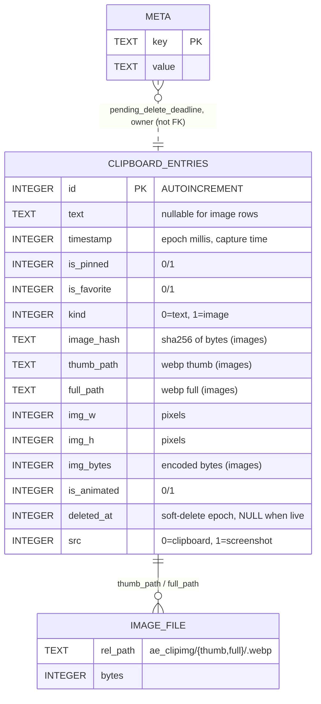

# Gboard+ — Database Design

- **Status:** Draft
- **Store:** SQLite via `SQLiteOpenHelper` (Android)
- **File:** `/data/data/com.google.android.inputmethod.latin/databases/clipboard.db`
- **Owner at runtime:** Gboard+ (the hook builds the DB from `InputMethodService.applicationContext`, i.e. **inside Gboard's process**)
- **Schema version:** stays **`1`** forever (additive `ALTER TABLE ADD COLUMN` only — see §4)

> **Adoption (REQ-FUNC-028):** Gboard+ opens the existing AE-created database in place. No data is
> dropped or recreated. The logical schema is unchanged; Gboard+ adds an idempotent **ownership
> marker** row to the meta table.

---

## 1. Entity-relationship diagram (Mermaid)



Indexes (implicit/created by usage): primary key on `CLIPBOARD_ENTRIES.id`; `META.key` is a key
column. Queries order by `timestamp` (and `is_pinned`, `is_favorite`) with a `deleted_at IS NULL`
live filter.

## 2. Table: `clipboard_entries`

| Column | Type | Null | Default | Notes |
|--------|------|------|---------|-------|
| `id` | INTEGER | no | autoincrement | Primary key |
| `text` | TEXT | yes | — | Text content; null for pure image rows |
| `timestamp` | INTEGER | no | — | Capture time (ms) |
| `is_pinned` | INTEGER | no | 0 | Exempt from pruning/eviction |
| `is_favorite` | INTEGER | no | 0 | Sort/flag only |
| `kind` | INTEGER | no | 0 | `0`=text (`KIND_TEXT`), `1`=image (`KIND_IMAGE`) |
| `image_hash` | TEXT | yes | — | Content hash; de-dup/refcount key |
| `thumb_path` | TEXT | yes | — | Thumbnail webp path |
| `full_path` | TEXT | yes | — | Full-size webp path |
| `img_w` | INTEGER | no | 0 | Full width (px) |
| `img_h` | INTEGER | no | 0 | Full height (px) |
| `img_bytes` | INTEGER | no | 0 | Encoded size (bytes); used by byte budget |
| `is_animated` | INTEGER | no | 0 | Animated image flag |
| `deleted_at` | INTEGER | yes | NULL | Soft-delete marker (undo window) |
| `src` | INTEGER | no | 0 | `0`=clipboard (`SRC_CLIPBOARD`), `1`=screenshot (`SRC_SCREENSHOT`) |

## 3. Table: `ae_meta`

Generic key/value store.

| Column | Type | Null | Notes |
|--------|------|------|-------|
| `key` | TEXT | no | Key column |
| `value` | TEXT | yes | Value |

Known keys:
| Key | Meaning |
|-----|---------|
| `pending_delete_deadline` | Commit deadline for soft-deleted rows (undo window) |
| `owner` | **Gboard+ ownership marker** (`io.github.imix667.gboardplus`) written idempotently on adoption |

> The table keeps its historical name `ae_meta` for byte-compatible adoption of existing
> databases. Gboard+ never reads/writes AE's *preferences* through it — this is only the vault DB.

## 4. Migration policy

- **Version is pinned at 1.** New columns are added by an idempotent `ensureColumns` pass driven by
  `PRAGMA table_info`, run on every open.
- Bumping the version was historically a data-loss event (`DROP TABLE` + recreate) and would break
  **downgrade**: an older build opening a higher `user_version` hits SQLiteOpenHelper's default
  `onDowngrade` and throws. Staying at 1 lets old builds open the file and simply ignore extra
  columns.
- Adoption is non-destructive: existing rows/columns are preserved; only the `owner` meta row is
  written when absent.

## 5. Image file store (sidecars)

Images are **not** BLOBs; bytes live as webp files and the DB stores paths.

```
<Gboard filesDir>/
  ae_clipimg/                 # adopted name; Gboard+ continues to read/write here
    thumb/<sha256>.webp       # downscaled thumbnail
    full/<sha256>.webp        # full-size (bounded by FULL_MAX_EDGE)
    tmp/                      # scratch during ingest (cleaned on failure)
```

- Identity = SHA-256 of the source bytes; identical content is stored once (refcounted by rows).
- Eviction deletes sidecars only when the last referencing row is gone
  (`hashRefCount` decides; the store never decides on its own).
- Sampling (`inSampleSize`) guarantees a very large source is never fully decoded in memory
  (REQ-NFR-008).

## 6. drawio

A companion `docs/database.drawio` (to be exported alongside this file) mirrors the Mermaid ERD:
entities `CLIPBOARD_ENTRIES`, `META`, `IMAGE_FILE`, with the sidecar relationship from
`thumb_path`/`full_path`. Open with the draw.io desktop/web editor.

## 7. Integrity rules

- `kind = 1` rows have `image_hash`, `thumb_path`, `full_path` non-null; `kind = 0` rows have `text`.
- Live = `deleted_at IS NULL`. All read queries filter live rows.
- Pruning (REQ-FUNC-014) and image eviction (REQ-FUNC-017) never touch `is_pinned = 1` rows.
- All DB access is guarded (`try/catch`) so a corrupt row degrades to a skipped entry, never a crash
  in Gboard (REQ-NFR-004).
